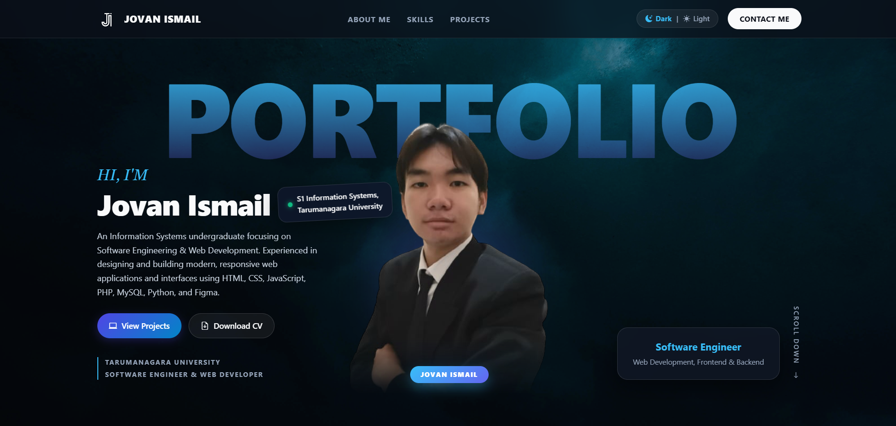

# Personal Web Developer Portfolio

> **Live Demo:** https://jovanismail.github.io/Portfolio/

Hi! I'm **Jovan Ismail**, an Information Systems undergraduate focusing on Software Engineering & Web Development. This is my responsive personal portfolio showcasing my projects, tech stack, and certifications.

### Key Features
* **Dark/Light Mode:** Dynamic theme switcher saved with `localStorage`.
* **Responsive UI:** Clean, modern layout built with HTML5, CSS3, Bootstrap 5, and JavaScript.
* **Interactive Showcase:** Categorized tabs for skills, tools, certificates, and featured projects.

### Tech Stack
HTML5 • CSS3 • JavaScript • Bootstrap 5

### Contact
* **Email:** ji.jovanismail@gmail.com
* **LinkedIn:** [linkedin.com/in/jovan-ismail](https://www.linkedin.com/in/jovan-ismail)
